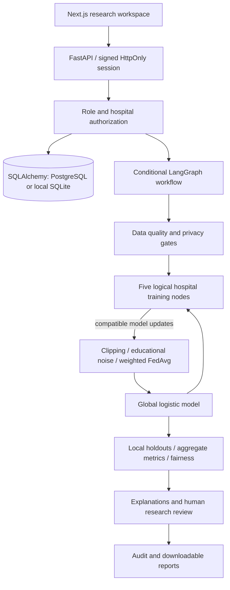

# MediFed AI

**Privacy-Preserving Federated Multi-Agent Framework for Collaborative Clinical Decision Support**

A working synthetic-data research platform built with Next.js, React, TypeScript, FastAPI, SQLAlchemy, NumPy, scikit-learn, and LangGraph. It demonstrates how five logical hospital nodes can train compatible models and combine sample-weighted parameters without sending source rows to a coordinator API.

> Experimental research only. Not a medical device, diagnosis, treatment recommendation, or validated privacy system. Never upload real patient data.

## What works

- Login, self-registration into a new isolated hospital sandbox, password reset demo, logout and JWT revocation; five backend-enforced roles.
- Five seeded synthetic institutions and 1,500 synthetic numeric records.
- Hospital registration, editing, participation controls, dataset CSV upload, schema/range checks, previews, missing-value and duplicate reports.
- Local logistic regression, random forest, and gradient boosting with stratified evaluation. Tree baselines stay local; their parameters are never incorrectly averaged.
- Iterative local logistic gradient training initialized from the previous global model, clipping, optional educational noise, weighted FedAvg, global redistribution via stored state, round history and model versions.
- Accuracy, precision, recall, F1, ROC-AUC, confusion matrix, synthetic demographic group metrics, exact linear log-odds contributions, review queue and reviewer comments.
- Eight executable rule-based agents in a conditional LangGraph workflow; failed quality/privacy gates stop execution. No paid LLM API needed.
- Privacy configuration and budget gating, model activation/archival, calculated analytics, audit trail, user roles/access, CSV and PDF report exports.
- Separate navigable module pages, global module/hospital search, notifications, responsive layouts, skeletons and error feedback.

## Architecture



The demonstration is one process with logical tenant boundaries. It is not a physically distributed hospital deployment. In the simulation, held-out labels and probabilities are combined in-process to calculate exact global metrics; source feature rows are not exposed by coordinator endpoints. A real deployment needs remote node services and a protocol that securely aggregates sufficient evaluation statistics.

## Local setup

Requirements: Node.js 22+ and Python 3.12. No paid services required.

```powershell
npm ci
python -m venv .venv
.\.venv\Scripts\Activate.ps1
python -m pip install -r requirements.txt
# Terminal 1, repository root
python -m uvicorn backend.app.main:app --reload --port 8000
# Terminal 2, repository root
npm run dev
```

Open http://localhost:3000. API documentation: http://localhost:8000/docs. The Next.js dev server proxies `/api/*` to port 8000. Set API_URL when using another backend. Local SQLite is created on first API import and seeds synthetic records. Do not commit database files.

Environment variables are documented in `.env.example`. Set backend variables in your shell or use `uvicorn --env-file` after installing python-dotenv; Python does not automatically load `.env`. Next.js reads `.env.local` for its own configuration.

## Demo credentials

Available only with `DEMO_MODE=true` (default for this educational demonstration). All accounts use password **MediFed-Demo-2026!**.

| Email | Role | Scope |
|---|---|---|
| super_admin@medifed.demo | Platform administrator | All synthetic tenants; training and workflow controls |
| hospital_admin@medifed.demo | Hospital administrator | Meridian private datasets |
| researcher@medifed.demo | Researcher | Meridian datasets and research outputs |
| clinician@medifed.demo | Clinician | Meridian predictions and research review |
| auditor@medifed.demo | Auditor | Aggregate models and platform audit; no private datasets |

Public credentials are intentional for synthetic demo use. Set `DEMO_MODE=false`, `JWT_SECRET`, `ADMIN_EMAIL`, and a strong `ADMIN_PASSWORD` for non-demo startup on a fresh database. Disable/remove demo users before reusing a seeded database.

## First end-to-end run

1. Sign in with the administrator demo or click **Enter research demo**.
2. Open Datasets, inspect a cohort, validate/preprocess it, and train any local baseline.
3. Open Federated Learning and start a round. No checked hospitals means all active participants; at least two are required.
4. Open AI Agents and run the workflow. Inspect each actual execution trace.
5. Open Clinical Research and generate a synthetic case; inspect linear contributions and add a research review comment.
6. Open Analytics, Model Registry, Privacy, Reports, and Audit Logs to inspect recorded evidence.
7. Export real CSV/PDF reports. Use the sample CSV download for upload testing.

## Learning and privacy details

The fed model uses a public, fixed synthetic feature center/scale and public reference mean imputation, avoiding holdout-fit leakage. Each node uses a 75/25 stratified split with seed 42, runs 100 local gradient steps, clips its parameter delta, optionally adds Gaussian noise, and contributes weighted updates. Subsequent rounds start from the current active global weights.

**Privacy limitations:** the Gaussian noise is educational, not a formal DP implementation. Epsilon/delta are experiment settings; the epsilon ledger is not a proven accountant. Pairwise additive masks cancel in weighted-sum space but do not implement a cryptographic secure aggregation protocol. The coordinator process can inspect updates in memory. TLS comes from the host; encryption at rest depends on database hosting. No HIPAA/GDPR or medical regulatory compliance is claimed.

Explanations are exact standardized linear log-odds contributions relative to public reference means, not SHAP. Probabilities are not calibrated. Fairness evaluates only two synthetic numeric gender categories and flags an accuracy gap above 0.10. These groups do not represent the complexity of real demographic fairness.

## Database

SQLAlchemy has `users`, `hospitals`, `settings`, and indexed UUID `records`. Dataset validation, rounds, local training, model versions/evaluations, privacy accounting, agent executions, cases/reviews and audit events use typed record payloads with hospital foreign keys. This compact schema deliberately differs from a fully normalized enterprise database. Source datasets and cases are protected by explicit backend tenant checks, including direct identifier requests. Role/participation updates use dedicated validated endpoints.

Set a PostgreSQL connection URL in `DATABASE_URL`; `postgres://` and `postgresql://` are normalized to the psycopg driver. Database tables are initialized automatically; schema versioning is deferred and documented as a limitation.

## Verification

```powershell
python -m unittest discover -s backend/tests -v
npm run typecheck
npm test
npm run build
```

Backend integration tests cover authentication/revocation, tenant API manipulation, roles, uploads, numeric validation, all three local baselines, numerical weighted FedAvg, round/workflow execution, privacy blocking, explanations, review permissions, reports, registration, and password reset. Frontend contract tests check route exposure and action integration; browser verification is described in the delivery notes.

## Deployment

See [deployment guide](docs/deployment.md). Vercel serves Next.js plus `api/index.py` (FastAPI). The root `vercel.json` rewrites API requests to the Python function, and root `requirements.txt` declares Python dependencies. A separate Render/Railway FastAPI deployment and PostgreSQL are supported through the documented configuration.

**Hosted demo storage:** without DATABASE_URL, Vercel uses `/tmp/medifed.db`. It is ephemeral and not shared across instances. Data, generated session keys, and sessions may reset on cold starts or scale-out. This is an explicitly temporary demonstration, not a durable multi-user production installation. Use PostgreSQL plus a stable JWT_SECRET for durable sessions and records.

## Limitations and next steps

- Logical in-process federation; no Flower remote transport, real hospital integration, or cryptographic secure aggregation.
- No formal differential privacy, SHAP, XGBoost, Redis, or generative LLM claims.
- Synchronous short training with UI polling; production needs durable workers/job queue and distributed locks.
- Compact JSON record schema; production needs normalized migrations, retention controls, stronger append-only audits, and database-level tenant policies.
- Database-backed per-minute throttles are basic and require cleanup; production needs atomic distributed rate limits.
- Password reset delivery is local/demo only. Non-demo requires administrator delivery integration; all-session password-reset invalidation is a future security hardening step.
- No model monitoring validation for real populations, medical use, calibrated confidence, or regulatory validation.
- Future: remote Flower clients, formal DP accounting, genuine secure aggregation, prospective fairness validation, calibrated models, and independently reviewed operations.
